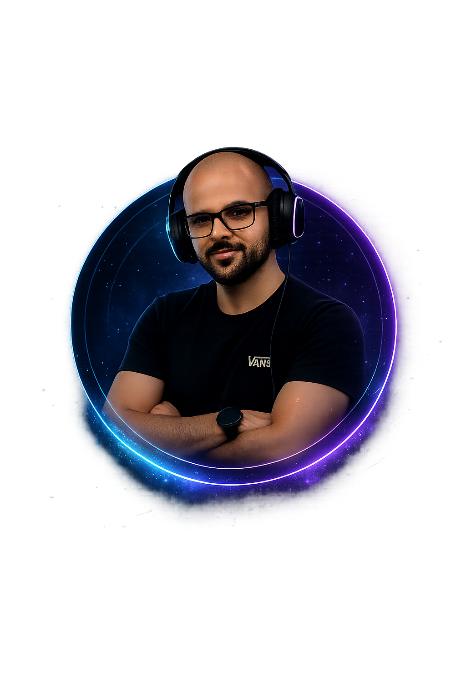

# 💻 Portfólio Profissional — Renan De Paula

<p align="center">
  
</p>

<p align="center">
  <strong>Desenvolvedor Full Stack com foco em Python, Django, JavaScript, React e tecnologias Web modernas.</strong>
</p>

<p align="center">
  <a href="https://renan-de-paula-portifolio.web.app" target="_blank">
    🌐 <strong>Acessar Site Oficial (Firebase Hosting)</strong>
  </a>
  &nbsp;•&nbsp;
  <a href="https://renan-de-paula.github.io/portifolio/" target="_blank">
    📄 Mirror GitHub Pages
  </a>
</p>

<p align="center">
  
  
  
</p>

---

# 📌 Sobre o Projeto

Este projeto é o meu **portfólio profissional oficial**, desenvolvido do zero para centralizar e apresentar minha trajetória como desenvolvedor: competências técnicas, qualificações acadêmicas, certificações em um mapa interativo e a vitrine dos projetos e aplicações web que construí.

### Destaques de Engenharia:
- **Carrossel 3D Cilíndrico:** Navegação imersiva entre os projetos construída com matemática tridimensional pura em JavaScript e CSS 3D transforms.
- **Grafo Interativo Sci-Fi:** Mapa de certificações e competências em rede utilizando `vis-network` para exploração visual dinâmica.
- **Tema Dark/Light:** Alternância completa de paleta de cores com conformidade de contraste e transições suaves.
- **Terminal Digital Rain:** Efeito de chuva digital estilo Matrix renderizado via Canvas HTML5.
- **Mobile-First & Responsividade:** Layout homologado para telas desde smartphones de 320px até monitores ultrawide 4K.

---

# 🚀 Projetos em Destaque

Abaixo estão os principais projetos desenvolvidos, abrangendo aplicações comerciais em produção, plataformas completas Full Stack, integrações de APIs e jogos:

| Projeto | Tecnologias Principais | Descrição Resumida | Links |
| :--- | :--- | :--- | :--- |
| **🏋️‍♂️ Ryan Oliveira Personal** | Tailwind CSS, JavaScript, Mobile-First, Firebase | Landing page de alta conversão em produção para Personal Trainer, com Calculadora Fitness inteligente (TMB, IMC, TDEE) e envio direto para WhatsApp. | [Site Oficial](https://ryanoliveira-personal.web.app/) • [GitHub](https://github.com/Renan-De-Paula/ryan-oliveira-personal) |
| **🚀 UniStudy Hub** | React 18, Vite, Tailwind, Python, Django DRF, PWA | Ecossistema educacional gamificado com ganho de XP, sala de foco Pomodoro com sons ambientes, acervo com editor Markdown e quizzes com selos automáticos. | [Live Demo](https://uni-study-4wyp.vercel.app/login) • [GitHub](https://github.com/Renan-De-Paula/UniStudy) |
| **🍰 Forno & Afeto – PDV** | Python, Django, SQLite, Bootstrap | Sistema de gestão de Ponto de Venda (PDV) para confeitaria artesanal desenvolvido como Projeto Integrador na UNIVESP (pedidos, clientes e financeiro). | [Live Demo](https://renan-de-paula.github.io/Projeto_integrador_1_Univesp/) • [GitHub](https://github.com/Renan-De-Paula/Projeto_integrador_1_Univesp) |
| **🏆 Show do Milhão Acadêmico** | Java 17, JavaFX, Maven, JSON | Jogo interativo de perguntas e respostas inspirado no Show do Milhão, com interface gráfica, efeitos sonoros e perguntas via JSON. | [GitHub](https://github.com/Renan-De-Paula/Show_Do_Milhao_Academico) |
| **🥊 Pantheon Fighters** | Python 3.11, Pygame, POO | Jogo de luta 2D estilo Street Fighter desenvolvido como projeto final no SENAI, com animações frame-a-frame e game loop estruturado. | [GitHub](https://github.com/Renan-De-Paula/Pantheon-Fighters) |
| **💉 VacinAPP** | Java 17, Spring Boot, MySQL, HTML/CSS/JS | Aplicação web de controle e agendamento de vacinação desenvolvida para o Projeto Integrador do 5º semestre do SENAC. | [Live Demo](https://renan-de-paula.github.io/PI-Quinto-semestre-VacinAPP/) • [GitHub](https://github.com/Renan-De-Paula/PI-Quinto-semestre-VacinAPP) |
| **🛹 Grind Culture – Skateshop** | HTML5, CSS3, JavaScript, API ViaCEP | E-commerce e loja virtual com carrinho de compras interativo, checkout e cálculo dinâmico de frete via API. | [Live Demo](https://grind-culture.web.app/) • [GitHub](https://github.com/Renan-De-Paula/Grind-Culture) |
| **📱 Teste de Touch Screen** | HTML5, CSS3, JavaScript Vanilla | Aplicação interativa desenvolvida para mapear toques na tela e diagnosticar eventos táteis em telas touchscreen. | [Live Demo](https://renan-de-paula.github.io/touchScreen_Test/) • [GitHub](https://github.com/Renan-De-Paula/touchScreen_Test) |
| **🏋️ Ironforge Fitness** | HTML5, CSS3, JavaScript | Landing page moderna e responsiva para academia de musculação de alta performance focada em conversão. | [Live Demo](https://renan-de-paula.github.io/IronForge/#inicio) • [GitHub](https://github.com/Renan-De-Paula/IronForge) |
| **🔴 Pokedex Interativa** | HTML5, CSS3, JavaScript, PokeAPI | Pokedex dinâmica desenvolvida com JavaScript puro consumindo dados em tempo real da PokeAPI REST. | [Live Demo](https://renan-de-paula.github.io/pokedex/) • [GitHub](https://github.com/Renan-De-Paula/pokedex) |
| **🧟 Metal Zombie** | Java, Lógica de Jogos | Jogo de tiro e sobrevivência 2D run-and-gun em estilo arcade contra hordas zumbis. | [GitHub](https://github.com/Renan-De-Paula/MetalZombie) |

---

# 🛠️ Tecnologias & Ferramentas Utilizadas

<div align="center">

| Categoria | Tecnologias |
| :--- | :--- |
| **Front-End** | HTML5 Semântico, CSS3 Moderno, JavaScript (ES6+), React 18, Tailwind CSS |
| **Back-End** | Python, Django, Django REST Framework, Java, Spring Boot |
| **Bancos de Dados** | MySQL, PostgreSQL, SQLite |
| **Cloud & Deploy** | Firebase Hosting, Vercel, GitHub Pages |
| **Bibliotecas & UI** | Vis-Network (Grafo Interativo), Font Awesome, Devicon, Google Fonts |
| **Versionamento & BI** | Git, GitHub, Power BI |

</div>

---

# 🎨 Funcionalidades do Portfólio

✅ **Carrossel 3D Interativo:** Efeito cilíndrico tridimensional com drag/touch e rotação automática  
✅ **Grafo Interativo Sci-Fi:** Mapa de habilidades e certificações renderizado via canvas interativo  
✅ **Tema Dark & Light:** Alternância completa com persistência no navegador  
✅ **Terminal Digital Rain:** Chuva de caracteres no background inspirada no terminal Matrix  
✅ **Modais Informativos:** Janelas detalhadas de experiências profissionais e cursos concluídos  
✅ **Botão de Download de CV:** Acesso direto ao currículo profissional em PDF  
✅ **Totalmente Responsivo:** Homologado de 320px até telas 4K  
✅ **Favicon Customizado:** Ícone em alta resolução com a marca oficial neon  

---

# 📂 Estrutura de Diretórios

```bash
portifolio/
│
├── index.html                    # Estrutura principal da página
├── firebase.json                 # Configurações de rotas e cache do Firebase Hosting
├── .firebaserc                   # Associação com o projeto Firebase
├── README.md                     # Documentação completa do projeto
│
└── src/
    ├── css/
    │   └── style.css             # Folha de estilos, temas Dark/Light e animações
    │
    ├── js/
    │   ├── main.js               # Carrossel 3D, temas, chuva digital e modais
    │   ├── graph.js              # Grafo interativo sci-fi (Vis-Network)
    │   └── electric-logo.js      # Efeito elétrico/neon sobre o logotipo SVG
    │
    └── img/
        ├── perfil.png            # Foto de perfil profissional
        ├── logoR.png             # Logotipo oficial
        ├── logoR.svg             # Logotipo vetorial
        ├── favicon.png           # Favicon do navegador
        ├── favicon-192.png       # Ícone mobile em alta resolução
        │
        ├── screenshots/          # Capturas de tela das seções
        │   ├── home.png / homelight.png
        │   ├── sobre.png / sobrelight.png
        │   ├── stack.png / stacklight.png
        │   ├── projetos.png / projetoslight.png
        │   └── contato.png / contatolight.png
        │
        └── projetos/             # Capas dos projetos em exibição
            ├── RyanOliveiraPersonal.png
            ├── unistudy.png
            ├── fornoAfetoPedidos.png
            ├── showmilhao.png
            ├── pantheonfighters.png
            ├── vacinApp.png
            ├── grind-Culture.png
            ├── testScreen.png
            ├── ironforge.png
            ├── pokedex.png
            └── MetalZombie.png
```

---

# ⚙️ Como Executar o Projeto Localmente

### 1️⃣ Clone o repositório
```bash
git clone https://github.com/Renan-De-Paula/portifolio.git
```

### 2️⃣ Acesse a pasta
```bash
cd portifolio
```

### 3️⃣ Execute no navegador
Basta abrir o arquivo `index.html` com dois cliques, ou utilizar a extensão **Live Server** no VS Code.

Para testar localmente com o Firebase CLI:
```bash
npx firebase-tools serve
```

---

# ☁️ Deploy em Produção

O portfólio está configurado com deploy contínuo no **Firebase Hosting**:

```bash
# Publicar nova versão no ar
npx firebase-tools deploy --only hosting
```

👉 **URL de Produção:** [https://renan-de-paula-portifolio.web.app](https://renan-de-paula-portifolio.web.app)

---

# 📬 Contato

### 👨‍💻 Renan De Paula
*Desenvolvedor Full Stack*

📍 **Localização:** São Paulo – SP  
📧 **E-mail:** [ads.renandepaula@gmail.com](mailto:ads.renandepaula@gmail.com)  
🐙 **GitHub:** [github.com/Renan-De-Paula](https://github.com/Renan-De-Paula)  
💼 **LinkedIn:** [linkedin.com/in/renan-de-paula-7ba232158](https://www.linkedin.com/in/renan-de-paula-7ba232158/)  

---

<p align="center">
  Desenvolvido com dedicação por Renan De Paula 🚀
</p>
